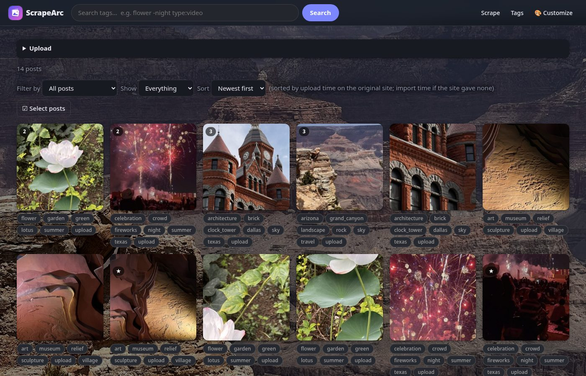
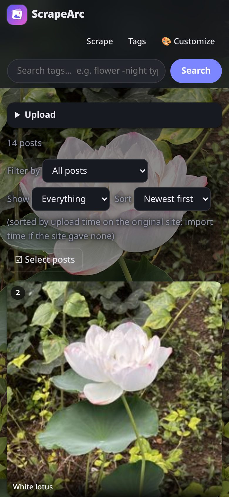

# ScrapeArc

A self-hosted photo and video archive with a scraper built in. Point it at a website's listing page, choose
keywords, and it saves matching posts with their pictures, titles, upload dates and tags into a private, searchable
gallery that you open from any device on your network.

One Docker container, one data folder, no database server.

<p align="center">
  
  
</p>

## What it does

- **Gallery with tags.** Search with `tag1 tag2 -excluded type:video title:word`. Filter by favorites, pictures,
  videos or possible duplicates, and sort by the date the post was made on the original site.
- **Your own tag types.** Decide what kinds of tags you keep (person, artist, place, …), each with its own colour and
  section. Scraped tags can be typed automatically by their position on the site.
- **Scraper that works on many sites.** No site is built in: it finds posts, titles, tags and media on its own, with
  CSS selectors as a fallback. Run it once, start from any page, stop at a date or a count, or let it rescan on a
  timer. You can also save a single post from its URL.
- **"Save to …" bookmark** for sites where you need to be logged in. Your own browser downloads the post, so the app
  never sees your password and nothing crawls the site.
- **No duplicate pictures.** If a post has resized copies of the same picture, only the largest is kept, but two shots
  that differ slightly (someone blinks) are both kept. Files you delete are never downloaded again.
- **Yours to customize.** Pick the app's name and icon the first time you open it, set separate desktop and phone
  backgrounds (with cropping), and change the colors. Name, icon and backgrounds are shared by all your devices.
- **Private by default.** It has a password login and stays on your own network. Add Tailscale for HTTPS from anywhere.

## Quick start

You need Docker with the Compose plugin.

```
git clone https://github.com/<you>/<repo>.git scrapearc && cd scrapearc
cp .env.minibooru.example .env.minibooru
nano .env.minibooru            # set MINIBOORU_PASSWORD and MINIBOORU_DATA_DIR (an absolute path)
make up                        # = docker compose ... up -d --build
```

Open `http://<this-machine>:8090`, log in with user `admin` and your password, and pick a name and icon.

Without Docker (for development): `python -m venv .venv && .venv/bin/pip install -r requirements-mini.txt && make dev`.

## Guides

| Guide | What it covers |
|---|---|
| [Installing with Docker](docs/install.md) | Full setup on Debian or Ubuntu, updates, backups, Proxmox LXC, troubleshooting |
| [Using the app](docs/usage.md) | Gallery, search, posts, tags, uploads, customizing |
| [Scraping](docs/scraping.md) | Run once, auto rescan, single posts, start page, selectors |
| [The "Save to …" bookmark](docs/bookmark.md) | Saving posts from sites that need a login |
| [HTTPS and access from anywhere](docs/remote-access.md) | Tailscale setup |
| [Encrypted data drive](docs/encrypted-drive.md) | Optional: keep the archive on a LUKS-encrypted disk |
| [Security](docs/security.md) | What is protected and how, and what you should do |
| [Development](minibooru/README.md) | Code layout, tests, adding import sources |

## Use it responsibly

This tool downloads content from websites. You are responsible for how you use it:

- **Follow each site's terms of service.** Many sites forbid automated downloading. If a site says no, don't scrape it.
- **Respect copyright.** Pictures and videos belong to their creators. Keep your archive for personal use; don't
  re-upload, sell or redistribute what you collect.
- **Be gentle with servers.** The scraper obeys `robots.txt`, waits between requests (2 seconds by default) and backs
  off when a site is struggling. Don't lower those limits or run many scrapers against the same site at once.
- **Don't collect private information about people**, and don't use it to get around paywalls or access controls.
  The bookmark only saves what your own account can already see.

The authors don't endorse any particular site and aren't responsible for how the software is used.

## Credits

- Screenshots: the background and demo posts are the author's own photos.
- Built with FastAPI, SQLite, Pillow, httpx and Beautiful Soup.

## License

[MIT](LICENSE) for the code.
