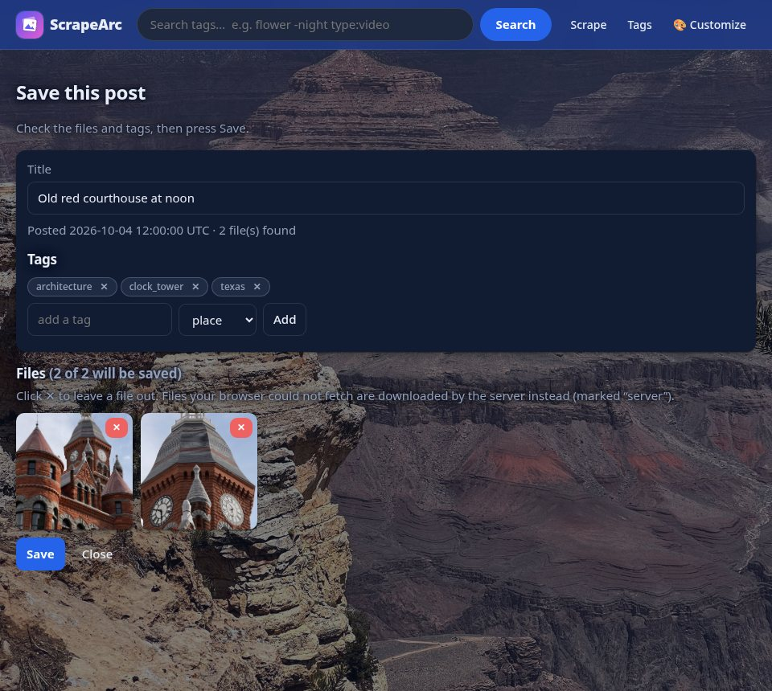

# The "Save to …" bookmark

Use this on a site where you have an account. Instead of scraping it, save posts one at a time with a bookmark. Your
own browser downloads the files with your own login, just like viewing the post. The app never logs in anywhere,
nothing crawls the site, and your password never reaches the app.

(The bookmark carries your app's name, so with the default name it says "Save to ScrapeArc".)

[← Back to the README](../README.md)

<!--  -->

## Add the bookmark (once per browser)

1. In the app, open **Scrape** → **Save to … bookmark**, or go to `<your app address>/clip/bookmarklet`.
2. Drag the **⭳ Save to …** button onto the **bookmarks bar** (the strip under the address bar). Dropping it on the ☆
   star icon doesn't work. Press **Ctrl+Shift+B** to show the bar if it's hidden.

If dragging doesn't work, make the bookmark by hand:

1. On that page, open **"Can't drag? Make it by hand"** and press **Copy**.
2. Open the bookmark manager (**Ctrl+Shift+O** in Chrome, Brave and Firefox) and add a new bookmark.
3. Name it **Save to …**, paste the copied text into the URL box, and save.

The bookmark is tied to the address you got it from. For example, one taken from `http://127.0.0.1:8090` saves into
that local copy, and one taken from your https address saves into the server. Get it again if you switch addresses.

## Use it

1. Open the post on the site, logged in as usual.
2. Click the bookmark. A small window opens with the post's pictures, title, upload date and tags. If the browser
   blocks the pop-up, allow pop-ups for that site and click again.
3. Leave out files you don't want (✕), fix the title, and remove or add tags.
4. Press **Save**. A bubble in the corner of the page shows **Saving…** and then **Saved**, and the window closes.

## What it does for you

- If the page has copies of the same picture (a thumbnail next to the full size), only the biggest is kept.
- Pictures you deleted from a post before are not saved again.
- The post is remembered: a normal scrape of that site skips it, and the window tells you when a post is already saved.
- Files your browser can't fetch (hosted on another domain) are downloaded by the server instead, if the site's
  robots.txt allows it.

## Remove it

Right-click the bookmark on the bookmarks bar and choose **Delete**, or find it in the bookmark manager.

## Troubleshooting

- **Nothing happens when you click it.** Some sites block bookmarks like this one (with a strict Content Security
  Policy). A small browser extension could do the same job.
- **No pictures were found, or the tags are wrong.** Fix them in the window before saving.
- **iPhone.** Mobile browsers limit bookmarks like this; use a computer.
