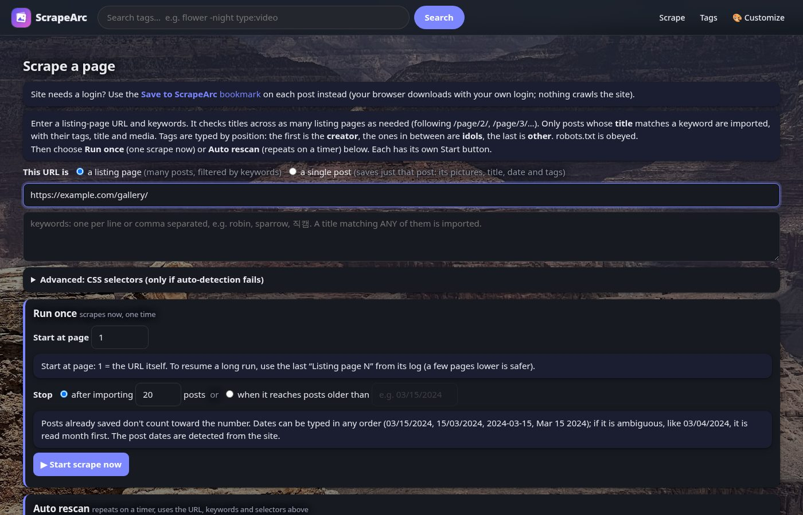

# Scraping

The **Scrape** page saves posts from a website into your archive. No site is built in: the scraper looks at the page
and works out where the posts, titles, dates, tags and pictures are.

Before scraping a site, read [Use it responsibly](../README.md#use-it-responsibly).

[← Back to the README](../README.md)



## 1. What to scrape

Paste a URL and choose what kind of page it is:

- **A listing page**: a page that lists many posts (a home page, a category, a tag page, search results). Only posts
  whose **title** contains one of your **keywords** are saved. Keywords are separated by commas, aren't case-sensitive,
  and match whole words. Korean and other scripts without spaces match anywhere in the title.
- **A single post**: saves just that one post with its pictures, title, date and tags. Keywords aren't used.
  Its tags all get the "in between" type of your position rule (see below), and tags longer than 12 letters are
  skipped (they are rarely names).

The scraper follows the listing's "next page" links on its own (`/page/2/` or `?page=2` style).

## 2. Run once

Scrapes now, one time.

- **Start at page**: begin further back in the listing. Useful to continue a long run you stopped: if it stopped at
  page 1511, start the next run at 1511. Pages before it are skipped.
- **Stop**:
  - **after importing N posts**, or
  - **when it reaches posts older than a date**: good for "everything since 2024-01-01". The run also ends by itself
    when the listing runs out of pages.

Press **▶ Start scrape now**. The page shows progress, the log and how long it has been running. **Stop** ends it
cleanly. Only one scrape runs at a time.

## 3. Auto rescan

Repeats on a timer (every 15 minutes or more) with the same URL, keywords and selectors. Each time it either finds up
to N new posts, or goes back to a date. Use it to keep an archive up to date with a site's newest posts. Press
**▶ Start auto rescan**. Auto rescans are listed under the form, where you can pause, run now, or delete them.

## History

Every run is listed under **History** with its result (found, imported, skipped, errors) and how long it took.

## Tag types

Scraped tags start as **other**. If the site lists each post's tags in a fixed order (say, author first), set the
position rule on the Tags page under **Tag types** and the scraper will type them for you: one type for the first
tag, one for the tags in between, one for the last. See [usage.md](usage.md#tag-types).

## What gets skipped

- Posts that were already saved, remembered by their URL, so stopping and restarting is safe.
- Files that are already in the archive (same content), and pictures you deleted from a post.
- Copies of the same picture inside one post (a resized version): only the biggest is kept. Two pictures that look
  almost the same but differ (for example someone blinks) are both kept.
- Tags you blocked on the Tags page.

## Being a polite client

The scraper obeys `robots.txt`, waits `MINIBOORU_SLEEP` seconds between requests (2 by default), retries a few times with
growing pauses when a site has trouble (429 or 5xx), and gives up on a run after repeated errors. It also refuses
private or internal addresses, so a page can't make it reach into your own network.

## When detection fails: CSS selectors

Open **Advanced: CSS selectors** to tell the scraper exactly where things are. Leave a field empty to keep the
automatic detection for it.

| Field | Points at | Example |
|---|---|---|
| Card | One post in the listing | `article.post` |
| Title | The title inside a card | `h2 a` |
| Tag | Tag links inside the card or post | `a[rel=tag]` |
| Media | The pictures/videos on the post page | `.entry-content img` |

Use your browser's **Inspect** tool (right-click → Inspect) to find them.

## Sites that need a login

Don't put passwords into the scraper. Use the [Save to … bookmark](bookmark.md) instead.

## From the command line

```
python -m minibooru import htmlscrape URL --keyword word1 --keyword word2 --pages 2
python -m minibooru import folder ~/Pictures/some-folder    # folder names become tags (birds/robin/x.jpg -> birds, robin)
python -m minibooru import gallerydl URL --title-field title --tag-field tags --limit 20
```
In Docker, put `mb exec minibooru` in front (see [install.md](install.md)).
