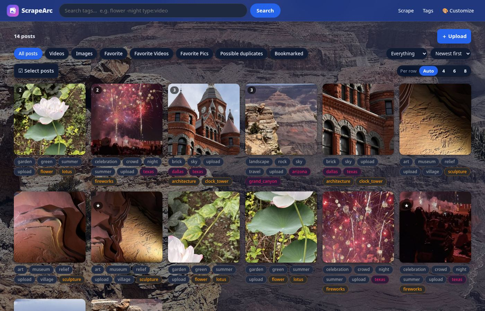
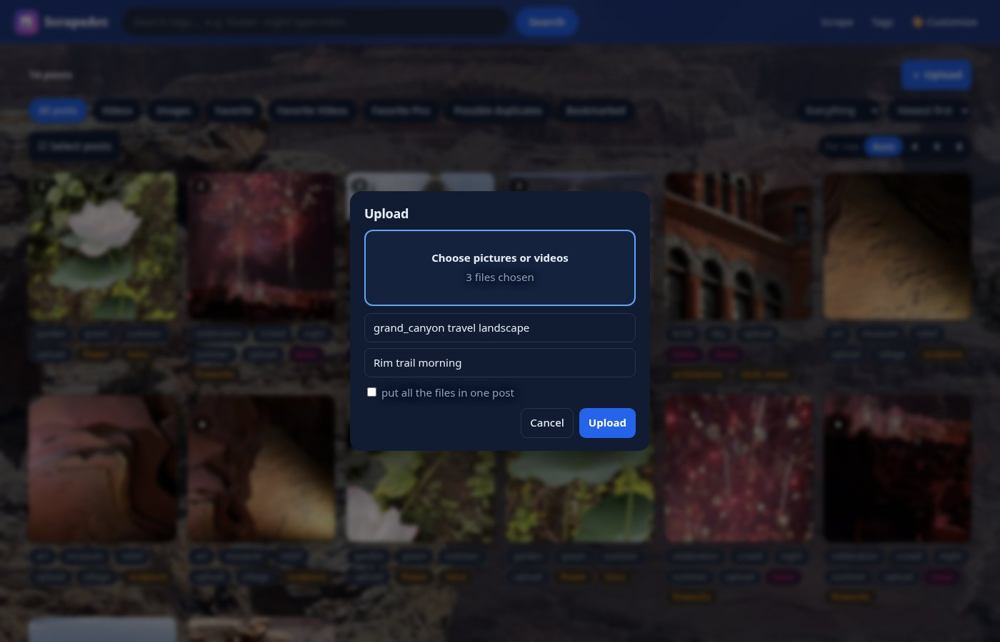
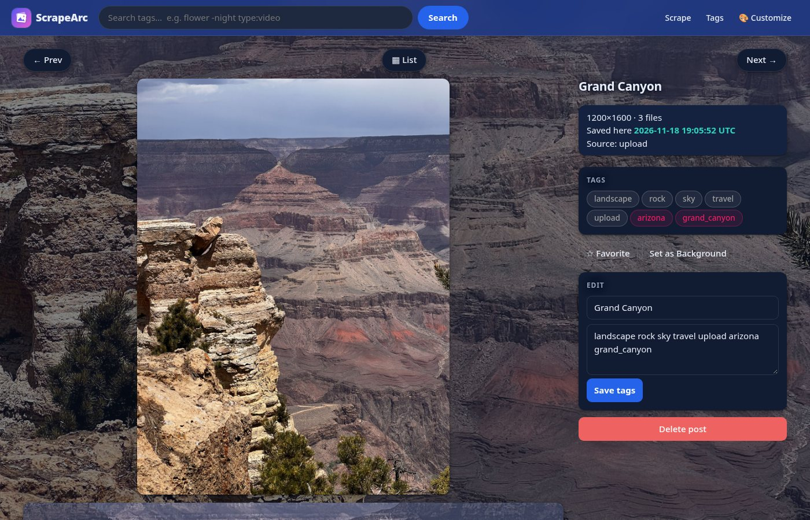
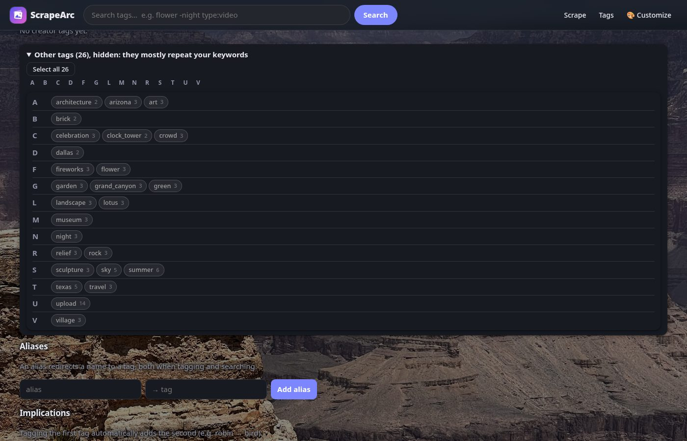
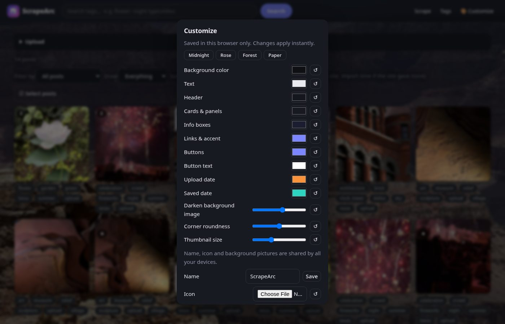
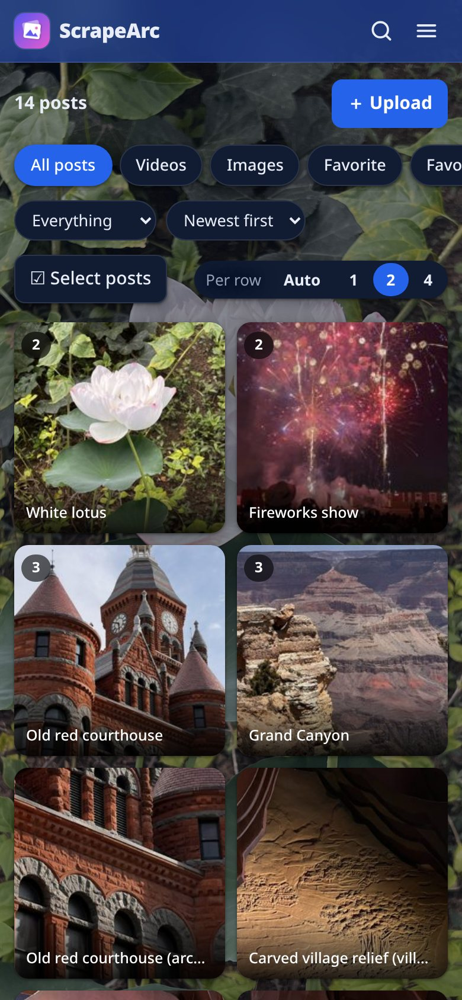
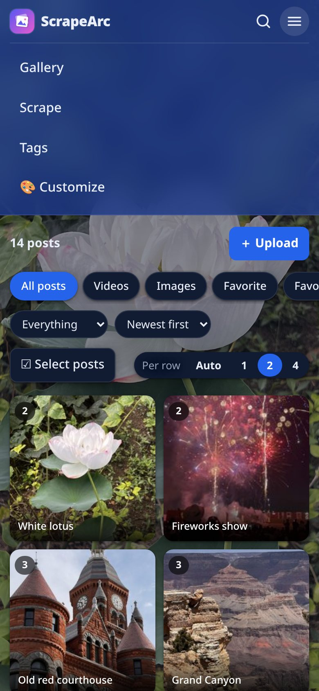
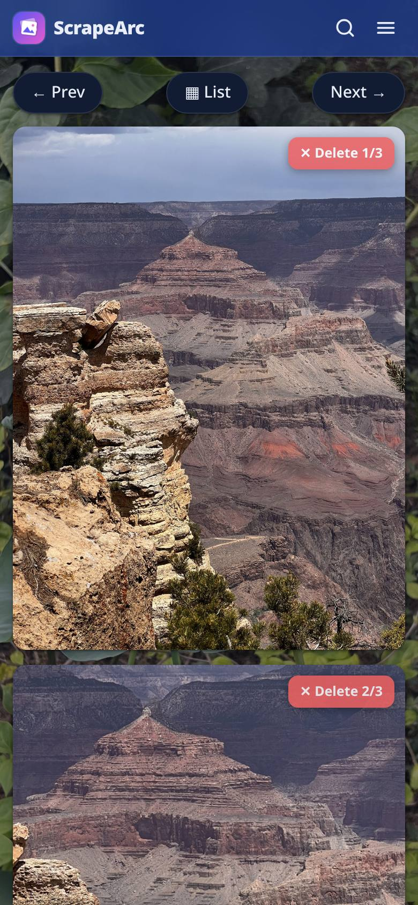

# Using the app

[← Back to the README](../README.md)

## First visit

Log in with user `admin` and the password from `.env.minibooru`. The first time, the app asks for a **name** (default
"ScrapeArc"), an optional **icon**, and optional **tag types** (see below). The name and icon show in the header
and the browser tab, and you can change them later in **Customize**. A new install starts with a plain dark blue
screen; add a background picture in Customize if you like.

## The gallery (front page)

- **Search** with tags separated by spaces. All of them must match.
  - `-tag` excludes a tag.
  - `type:video` or `type:image` shows only videos or only pictures.
  - `title:word` matches a word in the title.
  - A word that isn't a tag is looked for in titles instead (and `-word` hides titles containing it), so `lake`
    finds "Sunset over the lake" even without a *lake* tag.
  - Example: `tag1 tag2 -tag3 type:video`
- **Filter buttons** under the post count: all posts, videos, images, favorites (all, videos or pictures only),
  possible duplicates, and posts saved with the bookmark. On a phone, swipe the row sideways.
- **Everything / Uploads / Not uploads** narrows it to your own uploads or to scraped posts.
- **Newest / Oldest first** sorts by the date the post was made on the original site (the import time if the site
  gave none).
- **Per row** sets how many posts fit in a row (Auto, 4, 6 or 8 on a computer; Auto, 1, 2 or 4 on a phone).
- **Select posts** lets you tick posts and delete them together.
- Posts with several files show a count badge, and favorites a ★.

## Uploading

Press **＋ Upload** at the top of the gallery, then choose files or drop them on the box, and type tags separated by
spaces. Tick **put all the files in one post** to keep them together; otherwise each file becomes its own post. Pictures and videos are accepted (not iPhone
HEIC: export those as JPEG).

## A post

- The box under the title shows when the post was made on its site, when you saved it, and a link to the original.
- **Tags**: click one to see every post with it. Edit the title and tags in **Edit**, then **Save tags**.
- **★ Favorite** adds it to the favorites filter.
- **Delete a single file** of a multi-file post: hover over it and press its delete button. A deleted file is never
  downloaded again by later scrapes.
- **Set as Background**: choose a picture, crop it to a desktop or phone shape, and save.
- **Possible duplicates**: if another post looks like the same picture, the post page says so. Choose **Keep both**,
  **merge** (moves the tags over and deletes this one), or delete the other.
- **← Prev / Next →** (or the arrow keys) move through the same list you opened the post from: the same search,
  filter and sort. **▦ List** goes back to that list, scrolled to where you were.
- **Delete post** shows the next post in the list straight away. Back still takes you to your list, not to the deleted
  post. The duplicate buttons work the same way: one Back returns to the list.

## The Tags page

Tags are grouped by **type**, then by their first letter (A–Z, 0–9, and # for everything else); use the letter bar
to jump. Click a tag to see its type and post count, open it, change its type, or delete it.

To delete or change many tags at once, press **Select several**. Tick tags one by one, use the **all** button of a
letter, or use **Select all**, then use the bar at the bottom to change their type or delete them. You can also
block tags (they are never added by imports again), make aliases (two names for one tag), and implications
(tagging one tag automatically adds another).

### Tag types

You decide what kinds of tags you have, for example *person*, *artist* and *place*. Each type gets its own section
on the Tags page and its own colour on posts. **other** always exists: every tag without a type of its own goes
there, and on the Tags page it's folded away once you have other types.

Pick types on the first-run page, or at any time under **Tag types** at the bottom of the Tags page: add one, rename
it, change its colour, or delete it (its tags move to other; nothing is lost). Give a single tag a type from its
popup, or many at once with **Select several**. A tag that already has a type keeps it when a later import sees it as
other.

**Typing scraped tags by position.** Many sites list a post's tags in a fixed order, for example the author first,
then the people in the photo, then a general tag. Under **Scraping: type tags by their position** you can choose the
type for the *first* tag, the tags *in between*, and the *last* tag. The scraper and the Save bookmark then type tags
for you. Leave all three on *other* if your sites have no such order.

## Customize

Open **Customize** from the header (on a phone it's in the ☰ menu):

- **Name and icon** of the app.
- **Tags under posts**: show or hide the tag chips under each post on the front page, separately for computers and
  phones. By default they show on computers and are hidden on phones.
- **Backgrounds**: one for desktops and one for phones, cropped to the right shape. They're stored on the server, so
  every device you use gets them. **✕** removes one.
- **Customize screen →** opens a page for everything about how the app looks, with a live preview:
  - **Ready-made setups** (dark, light and high-contrast). Load one, then change anything. Every setup passes the
    WCAG readability minimums.
  - **Colours for every kind of box**: page, header, cards, info boxes, input boxes, main and other buttons, links
    and dates. Each text colour shows how readable it is on its box (aim for 4.5:1). Click a box in the preview to
    jump to its colours.
  - **Layout**: how much the background picture fades, corner roundness, thumbnail size, outlines around posts and
    tags under posts.

  Colours and layout are saved in that browser, so each device can look different.

## On a phone

  
  
  

- The header is one row: 🔍 opens the search box and ☰ opens the menu (Gallery, Scrape, Tags, Customize, Log out).
- **Add it to your Home Screen** to use it like an app: full screen, with its own icon. On an iPhone or iPad the app
  shows the steps once (Share → Add to Home Screen). In the home-screen app, **‹** goes back and **↻** reloads.
- The home-screen app **reopens where you left off**: the last post or list you had open on that device.

## Tips

- Everything (posts, tags, history, backgrounds, name, icon) lives in the data folder; back it up (see
  [install.md](install.md#6-backups)).
